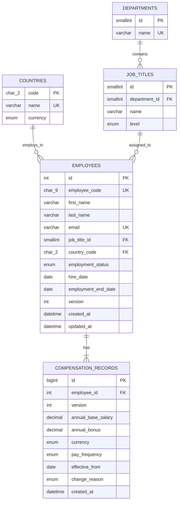

# Initial database schema

**Status:** Approved design. SQL migration is the next step.

## Goal

The first schema must import the generated workbook without losing data. It must also support immutable compensation history later.

This schema contains five tables:

1. `countries`
2. `departments`
3. `job_titles`
4. `employees`
5. `compensation_records`

HR users, permission scopes, import tracking, and general audit events are later migrations. They are not required by the first seed operation.

## Entity relationship diagram



## Table definitions

### `countries`

| Column | Type | Null | Rules |
|---|---|---:|---|
| `code` | `CHAR(2)` | No | Primary key. Values initially `IN` and `US`. |
| `name` | `VARCHAR(100)` | No | Unique. |
| `currency` | `ENUM('INR','USD')` | No | Default currency for the country. |

This table provides controlled country data. It also defines the expected country and currency pair.

### `departments`

| Column | Type | Null | Rules |
|---|---|---:|---|
| `id` | `SMALLINT UNSIGNED` | No | Auto-increment primary key. |
| `name` | `VARCHAR(100)` | No | Unique. |

Initial values are `Tech`, `HR`, `Finance`, `Operations`, and `Support`.

### `job_titles`

| Column | Type | Null | Rules |
|---|---|---:|---|
| `id` | `SMALLINT UNSIGNED` | No | Auto-increment primary key. |
| `department_id` | `SMALLINT UNSIGNED` | No | Foreign key to `departments.id`. |
| `name` | `VARCHAR(100)` | No | Job title text. |
| `level` | `ENUM('JUNIOR','MID','SENIOR','LEAD','MANAGER')` | No | Controlled employee level. |

Use a unique constraint on:

```text
(department_id, name, level)
```

An employee references a job title instead of storing department, title, and level independently. This prevents invalid combinations such as an HR title in the Tech department.

### `employees`

| Column | Type | Null | Rules |
|---|---|---:|---|
| `id` | `INT UNSIGNED` | No | Auto-increment primary key. |
| `employee_code` | `CHAR(9)` | No | Unique stable business identifier. |
| `first_name` | `VARCHAR(100)` | No | Non-empty application value. |
| `last_name` | `VARCHAR(100)` | No | Non-empty application value. |
| `email` | `VARCHAR(254)` | No | Unique. |
| `job_title_id` | `SMALLINT UNSIGNED` | No | Foreign key to `job_titles.id`. |
| `country_code` | `CHAR(2)` | No | Foreign key to `countries.code`. |
| `employment_status` | `ENUM('SOON_TO_JOIN','CURRENTLY_WORKING','LEFT')` | No | Current employment state. |
| `hire_date` | `DATE` | No | Start date or planned start date. |
| `employment_end_date` | `DATE` | Yes | Required only for `LEFT`. |
| `version` | `INT UNSIGNED` | No | Starts at 1. Used for optimistic concurrency later. |
| `created_at` | `DATETIME(3)` | No | Stored in UTC. |
| `updated_at` | `DATETIME(3)` | No | Stored in UTC. |

Use a database check for the status and end-date relationship:

```text
LEFT requires employment_end_date.
SOON_TO_JOIN and CURRENTLY_WORKING require a null employment_end_date.
```

Use a database check that an end date is later than the hire date when an end date exists.

Do not hard-delete an employee through normal application operations. Employees with status `LEFT` retain their compensation records.

An employee can change country or department. A department change uses a job title that belongs to the new department. The application will record those changes in a later audit migration.

### `compensation_records`

| Column | Type | Null | Rules |
|---|---|---:|---|
| `id` | `BIGINT UNSIGNED` | No | Auto-increment primary key. |
| `employee_id` | `INT UNSIGNED` | No | Foreign key to `employees.id`. |
| `version` | `INT UNSIGNED` | No | Starts at 1 for each employee. |
| `annual_base_salary` | `DECIMAL(15,2)` | No | Must be more than zero. |
| `annual_bonus` | `DECIMAL(15,2)` | No | Must be zero or more. |
| `currency` | `ENUM('INR','USD')` | No | Currency of salary and bonus. |
| `pay_frequency` | `ENUM('MONTHLY','ANNUAL')` | No | Payment frequency. |
| `effective_from` | `DATE` | No | First effective calendar date. |
| `change_reason` | `ENUM('INITIAL_IMPORT','PERFORMANCE','MARKET_ADJUSTMENT','PROMOTION','ROLE_CHANGE','CORRECTION')` | No | Reason for this version. |
| `created_at` | `DATETIME(3)` | No | Time when the record was written. Stored in UTC. |

Use a unique constraint on:

```text
(employee_id, version)
```

Use an index on:

```text
(employee_id, effective_from, version)
```

The current compensation for an as-of date is:

```sql
WHERE employee_id = ?
  AND effective_from <= ?
ORDER BY effective_from DESC, version DESC
LIMIT 1
```

Two records can have the same effective date. The higher version wins for that date. The system does not update or delete an older compensation record during a normal salary change.

The first workbook import creates version `1` with reason `INITIAL_IMPORT`.

## Money policy

`annual_base_salary` is authoritative. Do not store a second monthly salary value.

The application can calculate a monthly equivalent for display. The application must not use that rounded display value to reconstruct annual salary.

Use `DECIMAL(15,2)` for annual base salary and annual bonus. Do not use `FLOAT` or `DOUBLE`.

The database stores currency on each compensation record. This preserves the currency used by an older record if the employee later changes country.

The import operation must confirm that the compensation currency matches the employee country. A later country change that changes currency must create a new compensation record in the same transaction.

## Delete policy

Use restrictive foreign keys from employees to country and job title reference data.

Do not cascade-delete compensation history when an employee changes status. Normal application operations must use employment status instead of employee deletion.

The SQL migration must make an explicit choice for foreign key delete behavior. The preferred behavior is `RESTRICT` for reference and employee relationships.

## Initial import mapping

| Workbook column | Database destination |
|---|---|
| `employee_id` | `employees.employee_code` |
| `first_name` | `employees.first_name` |
| `last_name` | `employees.last_name` |
| `email` | `employees.email` |
| `department` | Resolve through `departments` and `job_titles`. |
| `job_title` | Resolve to `job_titles.id`. |
| `level` | Validate against `job_titles.level`. |
| `country_code` | `employees.country_code` |
| `currency` | `compensation_records.currency` |
| `employment_status` | `employees.employment_status` |
| `hire_date` | `employees.hire_date` |
| `employment_end_date` | `employees.employment_end_date` |
| `annual_base_salary` | `compensation_records.annual_base_salary` |
| `pay_frequency` | `compensation_records.pay_frequency` |
| `annual_bonus` | `compensation_records.annual_bonus` |
| `salary_effective_date` | `compensation_records.effective_from` |

The import inserts one employee row and one compensation record in one transaction.

## Deferred tables

The first migration does not contain:

- HR users and sessions.
- Country and department access scopes.
- Import jobs and row errors.
- General audit events.
- AI conversations or tool calls.

These tables will be designed when their first application workflow starts.

## Known trade-offs

- MySQL `ENUM` gives strict values but requires a migration when values change. The candidate accepts this trade-off.
- Job title owns department and level. This prevents inconsistent combinations, but a title or level change requires a new job title assignment.
- Employee country and job title store current organizational placement only. Their history needs the later audit design.
- Compensation history supports multiple changes on one effective date. Version order resolves the current record for that date.
